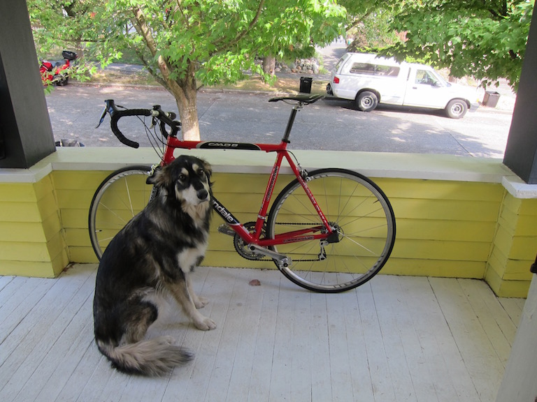

# mnn-yolo

[MNN](https://github.com/alibaba/MNN) deployment demos for the YOLO family,
including a task-oriented Python example for newer Ultralytics exports.

## New: YOLO26 and task-oriented Python inference

[`python/yolo_tasks.py`](python/yolo_tasks.py) supports Ultralytics-style
fixed-shape MNN exports for detection, instance segmentation, semantic
segmentation, pose, oriented boxes, classification and depth estimation. It
handles the end-to-end outputs used by YOLO26 and the raw outputs used by
YOLOv8/YOLO11. Instance and semantic segmentation are distinct:
the former produces a mask per object, the latter a class ID per pixel.

The new path was exercised with official YOLO26n checkpoints for all seven
tasks. YOLO26 instance masks, semantic classes, depth, classification and an
OBB detection were compared with the same exported ONNX models through
Ultralytics; YOLO11 instance masks were compared with its PyTorch checkpoint. See
the [Python guide](python/README.md#task-oriented-demo-yolov8-yolo11-and-yolo26)
for export commands, assumptions, and validation status. Existing C++ demos
have not been extended to YOLO26; in particular the old YOLO11 segmentation
demo reports mask statistics but does not draw pixel masks.

## Supported models

| family | task | export source |
|--------|------|---------------|
| YOLOv5 / v6 / v7 / v8 / v9 / v10 | detection | onnx → mnn |
| YOLO11 / YOLOv12 / YOLOv13       | detection | ultralytics native `format='mnn'` |
| YOLO11-seg                       | instance segmentation (Python task demo); old C++ demo reports mask statistics only | ONNX → MNN |
| YOLO11-pose                      | human pose (17 kpts) | ultralytics native |
| YOLO11-obb                       | rotated boxes (DOTA-v1) | ultralytics native |
| YOLOE                            | open-vocabulary detection | ultralytics native (with `set_classes`) |

## Pretrained MNN models

The seven YOLO26n task models are available on
[ModelScope: zhaode/mnn-yolo](https://modelscope.cn/models/zhaode/mnn-yolo).
For example:

```bash
pip install modelscope
modelscope download --model zhaode/mnn-yolo yolo26n.mnn --local_dir ./models
python python/yolo_tasks.py --model models/yolo26n.mnn --img resource/test.jpg --task detect
```

The ModelScope model card lists task-specific filenames, input sizes and
checksums. The earlier detection models below are available in the same
repository; substitute the desired filename in the download command.

| Model filename | Size | Converted from | MNN |
|-------|------|----------------|-----|
| yolov5n.mnn | 4 MB | ONNX | 2.8.1 |
| yolov5s.mnn | 14 MB | ONNX | 2.8.1 |
| yolov6n.mnn | 9 MB | ONNX | 2.8.1 |
| yolov6s.mnn | 36 MB | ONNX | 2.8.1 |
| yolov7tiny.mnn | 12 MB | ONNX | 2.8.1 |
| yolov7.mnn | 71 MB | ONNX | 2.8.1 |
| yolov8n.mnn | 12 MB | ONNX | 2.4.0 |
| yolov8s.mnn | 43 MB | ONNX | 2.4.0 |
| yolov9c.mnn | 98 MB | ONNX | 2.8.1 |
| yolov9e.mnn | 133 MB | ONNX | 2.8.1 |
| yolov10n.mnn | 4 MB | ONNX | 2.9.2 |
| yolov10s.mnn | 14 MB | ONNX | 2.9.2 |
| yolo11n.mnn | 5 MB | ONNX | 2.9.5 |
| yolo11s.mnn | 18 MB | ONNX | 2.9.5 |
| yolo11m.mnn | 38 MB | ONNX | 2.9.5 |
| yolo11l.mnn | 48 MB | ONNX | 2.9.5 |
| yolo11x.mnn | 109 MB | ONNX | 2.9.5 |

For yolo12 / yolo13 / yoloe / yolo11-seg / yolo11-pose / yolo11-obb, export
your own model. Availability of an export path and its output layout depend on
the model source and Ultralytics version; YOLO13 requires its own upstream
implementation and is not guaranteed to work with the stock package.

## Export to MNN

### Option 1: ultralytics native (where supported by your package version)

```python
from ultralytics import YOLO
model = YOLO("yolo11n.pt")     # or yolo12n.pt, yolo13n.pt, yolo11n-seg.pt, ...
model.export(format="mnn")     # writes yolo11n.mnn
```

For YOLOE, set the open-vocabulary classes before export:

```python
from ultralytics import YOLOE
model = YOLOE("yoloe-v8s-seg.pt")
names = ["person", "bus"]
model.set_classes(names, model.get_text_pe(names))
model.export(format="mnn")
```

### Option 2: onnx → MNNConvert (for v5 / v6 / v7 / v9 / v10)

`export/yolo_export.py` wraps both steps:

```bash
python export/yolo_export.py /path/to/yolov8n.pt
```

## Run a demo

- [Python demos](./python/) — `python python/yolo11_demo.py --model yolo11n.mnn --img resource/test.jpg`
- [C++ demos](./cpp/) — `./yolo11_demo yolo11n.mnn ../../resource/test.jpg`

The C++ folder includes platform-specific build instructions.

## Result



## References

- [yolov5](https://github.com/ultralytics/yolov5)
- [yolov6](https://github.com/meituan/YOLOv6)
- [yolov7](https://github.com/WongKinYiu/yolov7)
- [yolov8](https://github.com/ultralytics/ultralytics)
- [yolov9](https://github.com/WongKinYiu/yolov9)
- [yolov10](https://github.com/THU-MIG/yolov10)
- [yolo11](https://github.com/ultralytics/ultralytics)
- [yolov12](https://github.com/sunsmarterjie/yolov12)
- [yolov13](https://github.com/iMoonLab/yolov13)
- [yoloe](https://github.com/THU-MIG/yoloe)
